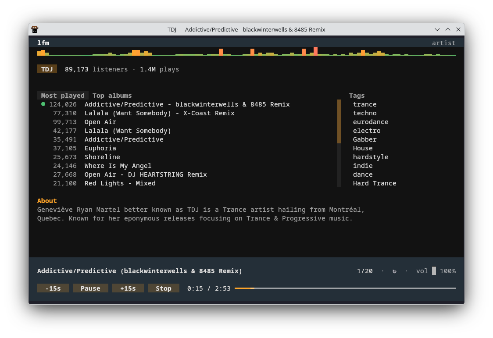

# lfm



I wanted to have a simple music player that could leverage the Last.fm recommendation system and be able to listen to artist radios, so I vibe-coded this TUI music player based on yt-dlp, mpv and the Last.fm API. It also has scrobbling support. You must provide your own Last.fm API key. 

## Install

Python 3.13+ and [uv](https://docs.astral.sh/uv/).

```
git clone https://github.com/aivarsse/lfm.git
cd lfm
uv tool install .
```

Playback needs `mpv` and `yt-dlp` on `PATH`. 

The equalizer strip is cosmetic and needs `cava`.

A Last.fm API key goes in `LFM_API_KEY` variable or in the config file, `lfm config` prints the path.

## Usage

### Browser

`lfm` on its own opens the full-screen browser. `h` lists every key.

### CLI

```
lfm similar <artist>
lfm walk <artist>
lfm radio <artist> <song>
```

Other commands include `info`, `blend`, `recent`, `cache`, `auth` and `scrobble`. `lfm --help`
lists them, and `lfm <command> --help` their options.

## Notes

- Playing a track is a YouTube search behind the scenes — `yt-dlp` searches for `artist - track`, picks a result and resolves it to a playable audio URL, and `mpv` plays that URL. Cava listens to the system's audio stream and visualizes the equalizer.
- The first play takes the top search hit and remembers it. When that is the wrong recording, you can list the sources with `y` and the choice will be remembered for that track.
- Responses are cached for a week. `lfm cache --clear` empties the cache, and `--no-cache` skips it for a single run.
- Scrobbling waits for `lfm auth`, which approves lfm on last.fm once and keeps the key. Plays are held locally until `lfm scrobble` sends them, so an offline session still scrobbles.
